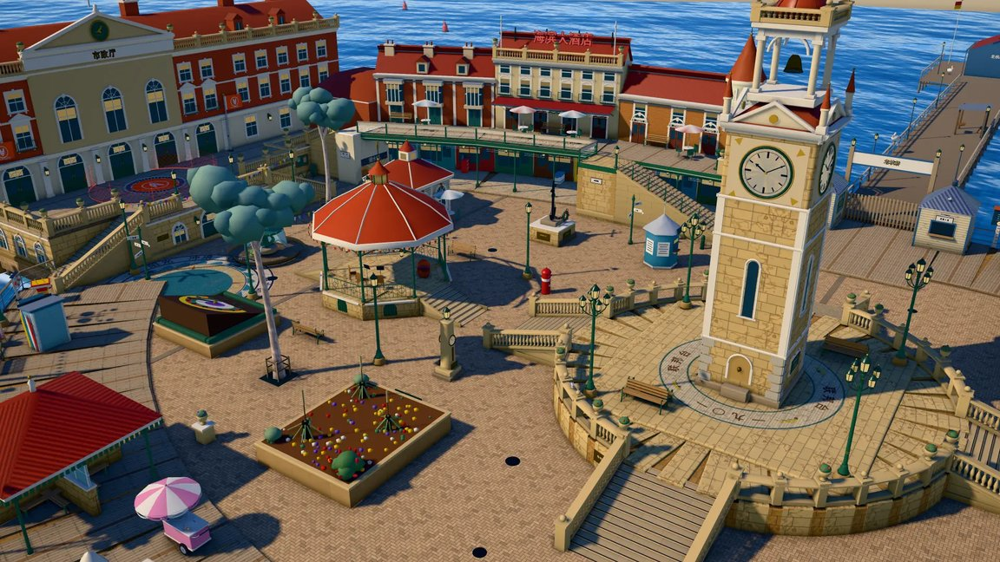
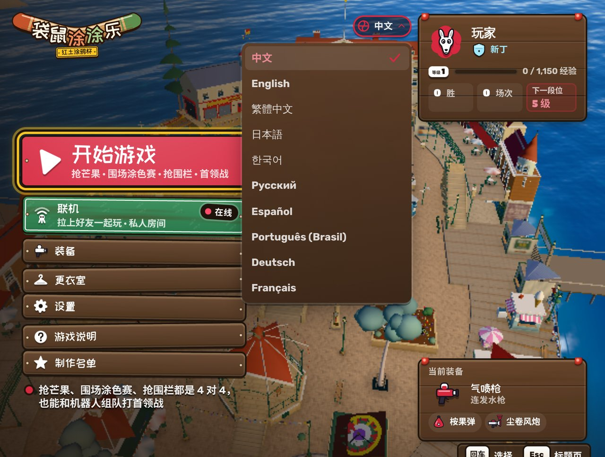
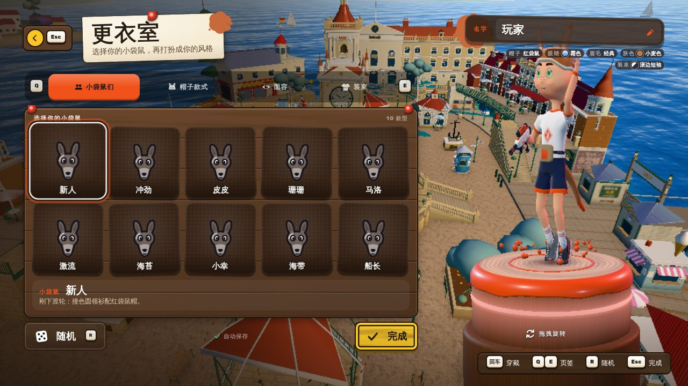
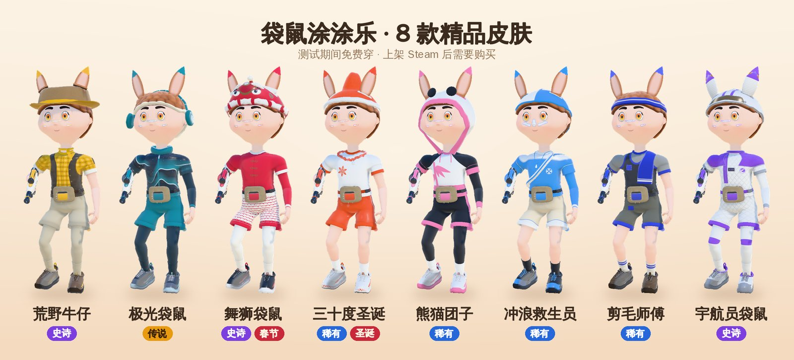

# 🦘 Roo Paint Party · 袋鼠涂涂乐

**A 3D, 4-vs-4 multiplayer party game about kangaroos, mangoes and Australian towns. Runs in the browser on phones and PCs, and as a Windows desktop app (Steam release in preparation).**

**一款以袋鼠为主角的 3D 4对4 多人派对游戏，手机和电脑浏览器都能玩，也打包成了 Windows 桌面版（正在准备上架 Steam）。**

[English](#english) · [中文](#中文)

> 📌 This repository is a **project showcase** (description and screenshots only). The game's source code is kept private.
> 本仓库只用来**展示项目**（介绍和截图），游戏源代码不公开。

---

## English

### What it is

Roo Paint Party is a fast, colourful team game. Two teams of four kangaroos hop, double-jump and wall-jump around eight hand-built Australian maps. Play against AI bots on your own, or open a private room and play online with friends on any device.

The headline mode is **Mango Grab**: mangoes drop onto the map in waves, you grab one, carry it in your pouch and bounce it home to your team's esky. Kick an opponent and the mango flies out of their pouch for anyone to grab. Fall in the water and a lifebuoy pulls you back.

### Highlights

| | |
|---|---|
| 🎮 **Modes** | Mango Grab (new), team modes Paint Cup and Fence Grab, and a co-op boss battle with bots |
| 🤖 **AI bots** | Bots fill empty slots, with three difficulty levels |
| 🌐 **Online play** | Private rooms with 5-digit room codes, served by a self-hosted Node.js WebSocket server |
| 📱 **Cross-platform** | Phones (touch controls, landscape), PC browsers (keyboard + mouse), Windows desktop app; iPhone players can add it to the home screen as an app |
| 🗺️ **8 Australian maps** | Tidewater Plaza, Lobster Bay Wharf, Pelican Bay Jetty, Inland Salt Lake, Jacaranda Town, Red Gum Lock, Terrace Heights, Red Dirt Freight Yard, each with day and dusk lighting |
| 🌏 **10 languages** | English, 简体中文, 繁體中文, 日本語, 한국어, Русский, Español, Português (Brasil), Deutsch, Français, switchable live |
| 👕 **8 original skins** | Cowboy, Aurora, Lion Dance, Aussie Christmas, Panda, Surf Lifesaver, Shearer, Astronaut |
| ⚡ **Performance** | Tuned to stay smooth and sharp on phones; integrated-GPU PCs automatically get a lighter quality preset and hold 60 fps |

### Screenshots

| Main menu with live language switcher | Online lobby (private room) |
|---|---|
|  |  |

| Jacaranda Town | Pelican Bay Jetty |
|---|---|
|  |  |

| Locker room | Giant kangaroo special move |
|---|---|
|  |  |

**The 8 premium skins**

### Tech stack

- **Game client:** JavaScript (ES modules), **Three.js** for 3D rendering, Web Audio, PWA manifest
- **Multiplayer server:** **Node.js** + WebSocket (`ws`), room codes, server-side match flow, load testing script
- **Deployment:** Linux cloud server, Nginx, PM2, Docker config
- **Desktop build:** **Electron** Windows app with first-launch language picker, fullscreen toggle and pause menu
- **Content pipeline:** build scripts for map checks, baked ambient occlusion and asset precompression

### My role

I lead this project end to end: game design (the Mango Grab mode, Australian theme, maps and skins), art direction, UI/UX for phones and PC, localisation into 10 languages, playtesting on real devices, server deployment and the Steam release. Development is AI-assisted (Claude Code), with me directing, reviewing and testing every change.

### Credits

Built on top of the open-source game engine [inkwave](https://github.com/jaydendavisnc/inkwave) by jaydendavisnc (MIT License). The kangaroo theme, Mango Grab mode, Australian maps, skins, localisation and desktop build are new work for this project.

---

## 中文

### 这是什么

《袋鼠涂涂乐》是一款节奏快、色彩明亮的团队游戏。两队各 4 只袋鼠，在 8 张以澳大利亚小镇为原型的地图上蹦跳、二段跳、蹬墙跳。可以一个人和电脑人机对战，也可以开私人房间，和朋友用手机或电脑联机。

主打玩法是**「蹦蹦抢芒果」**：芒果一波波从天上掉下来，抢到就装进育儿袋，蹦回自家冰桶得分；一脚把对手蹬飞，他袋里的芒果就会掉出来，谁都能抢；掉进水里还有救生圈把你拉回来。

### 亮点

- 🎮 **玩法**：抢芒果（新玩法）、团队区域争夺、和机器人一起打的首领战
- 🤖 **人机**：空位自动补机器人，三档难度
- 🌐 **联机**：5 位房间码私人房间，自己搭建的 Node.js WebSocket 服务器
- 📱 **全平台**：手机触屏（横屏）、电脑浏览器（键鼠）、Windows 桌面版；iPhone 可以「添加到主屏幕」当 App 用
- 🗺️ **8 张澳洲地图**：潮水广场、龙虾湾渔港、鹈鹕湾栈桥、内陆盐湖、蓝花楹镇、红桉船闸、阶梯高地、红土货场，每张都有白天和黄昏
- 🌏 **10 种语言**，游戏里随时切换
- 👕 **8 款原创精品皮肤**：荒野牛仔、极光袋鼠、舞狮袋鼠、三十度圣诞、熊猫团子、冲浪救生员、剪毛师傅、宇航员袋鼠
- ⚡ **性能**：手机上流畅又清晰；只有集成显卡的电脑自动用低画质，稳定 60 帧

### 技术栈

Three.js（3D 渲染）· JavaScript · Node.js + WebSocket（联机服务器）· Nginx · PM2 · Docker · Electron（Windows 桌面版）· PWA

### 我的角色

我负责整个项目：玩法设计（抢芒果、澳洲主题、地图和皮肤）、美术方向、手机和电脑的界面体验、10 种语言本地化、真机试玩测试、服务器部署和 Steam 上架。开发过程借助 AI 编程工具（Claude Code），由我提需求、把关和测试每一次改动。

### 鸣谢

基于 jaydendavisnc 的开源项目 [inkwave](https://github.com/jaydendavisnc/inkwave)（MIT 协议）。袋鼠主题、抢芒果玩法、澳洲地图、皮肤、多语言和桌面版是本项目新做的内容。

---

*Screenshots are real in-game captures. © hankun. All rights reserved for the screenshots and original content in this repository.*
