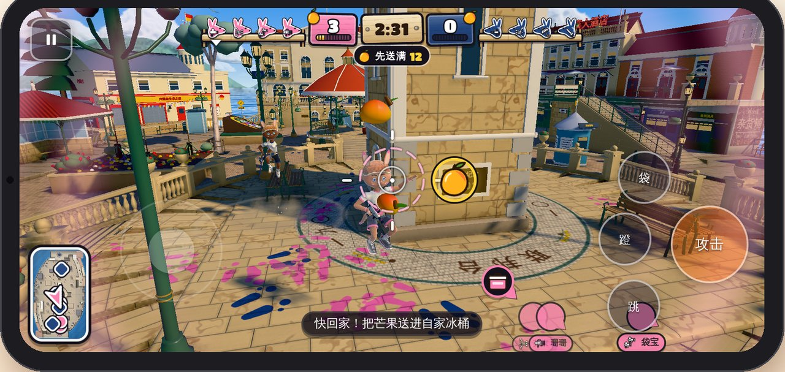
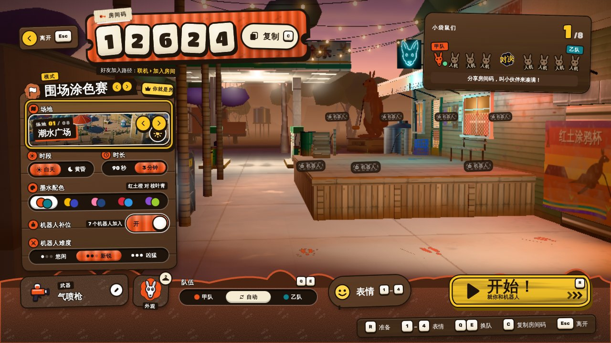
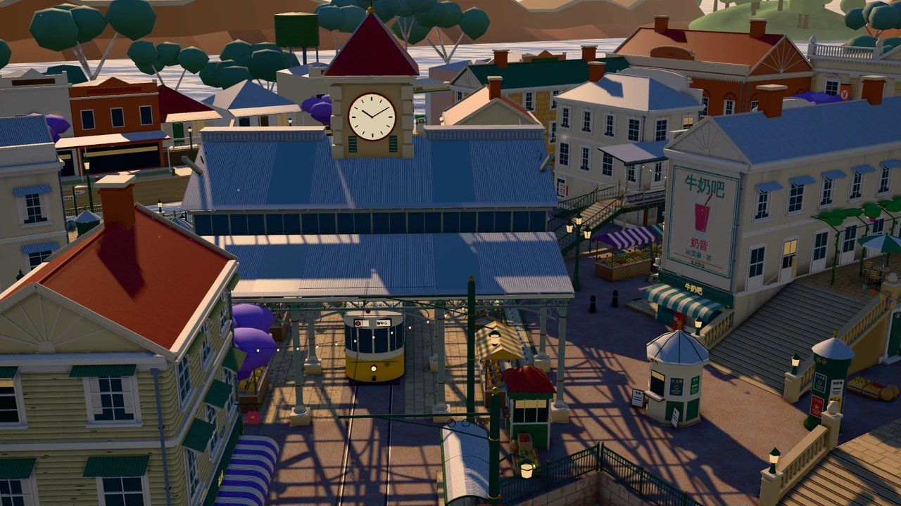
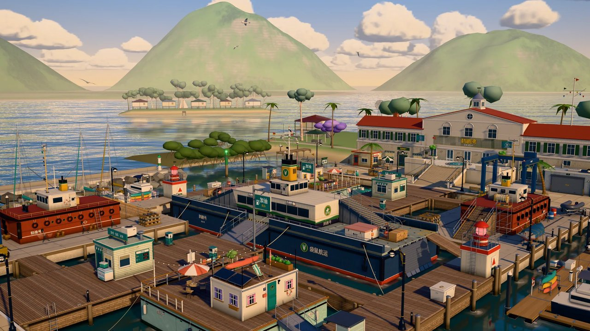
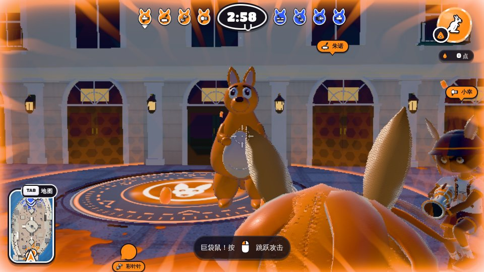

# 🦘 袋鼠涂涂乐（Roo Paint Party）

**一款以袋鼠为主角的 3D 4对4 多人派对游戏。手机、电脑浏览器打开就能玩，也打包成了 Windows 桌面版，正在准备上架 Steam。**

> 📌 本仓库仅用于**项目展示**（项目介绍 + 游戏截图），游戏源代码不公开。

## 项目简介

《袋鼠涂涂乐》是一款节奏快、色彩明亮的团队对战游戏。两队各 4 只袋鼠，在 8 张以澳大利亚城镇为原型的地图上蹦跳、二段跳、蹬墙跳。可以一个人和电脑人机对战，也可以开私人房间，和朋友用手机或电脑跨设备联机。

主打玩法是**「蹦蹦抢芒果」**：芒果一波波从天上掉下来，抢到就装进育儿袋，蹦回自家冰桶得分；一脚把对手蹬飞，他袋里的芒果就会掉出来，谁都能抢；掉进水里还有救生圈把你拉回来。

## 项目亮点

| | |
|---|---|
| 🎮 **多种玩法** | 蹦蹦抢芒果（原创新玩法）、围场涂色赛、抢围栏，以及和机器人组队的首领战 |
| 🤖 **人机对战** | 空位自动补机器人，悠闲 / 新锐 / 凶猛三档难度 |
| 🌐 **在线联机** | 5 位房间码私人房间，自主搭建并部署的 Node.js WebSocket 联机服务器 |
| 📱 **多端运行** | 手机触屏（横屏）、电脑浏览器（键盘 + 鼠标）、Windows 桌面版；iPhone 可「添加到主屏幕」当 App 使用 |
| 🗺️ **8 张澳洲地图** | 潮水广场、龙虾湾渔港、鹈鹕湾栈桥、内陆盐湖、蓝花楹镇、红桉船闸、阶梯高地、红土货场，每张都有白天和黄昏两种光照 |
| 🌏 **10 种语言** | 简体中文、繁體中文、English、日本語、한국어、Русский、Español、Português、Deutsch、Français，游戏内随时切换 |
| 👕 **8 款原创皮肤** | 荒野牛仔、极光袋鼠、舞狮袋鼠、三十度圣诞、熊猫团子、冲浪救生员、剪毛师傅、宇航员袋鼠 |
| ⚡ **性能优化** | 针对手机做了流畅度和清晰度优化；只有集成显卡的电脑自动切换低画质，稳定 60 帧 |

## 游戏截图

| 主菜单（10 种语言随时切换） | 联机大厅（私人房间） |
|---|---|
|  |  |

| 地图：蓝花楹镇 | 地图：鹈鹕湾栈桥 |
|---|---|
|  |  |

| 更衣室 | 大招：巨袋鼠 |
|---|---|
|  |  |

**8 款原创精品皮肤**

## 技术栈

- **游戏客户端**：JavaScript（ES Modules）、**Three.js** 3D 渲染、Web Audio、PWA
- **联机服务器**：**Node.js** + WebSocket（ws），房间码匹配、服务端对局流程、压力测试脚本
- **部署运维**：Linux 云服务器、Nginx、PM2、Docker
- **桌面版**：**Electron** 打包 Windows 程序，含首次启动选语言、全屏切换、暂停菜单
- **资源工具链**：地图校验、环境光遮蔽烘焙、资源预压缩等构建脚本

## 我的角色

担任项目负责人，全程主导：玩法设计（抢芒果玩法、澳洲主题、地图和皮肤）、美术风格把控、手机和电脑端的界面与交互、10 种语言本地化、真机试玩测试、服务器部署上线，以及 Steam 上架。开发过程借助 AI 编程工具（Claude Code），由我提出需求、审核并测试每一次改动。

## 鸣谢

本项目基于 jaydendavisnc 的开源项目 [inkwave](https://github.com/jaydendavisnc/inkwave)（MIT 开源协议）二次开发。袋鼠主题、抢芒果玩法、澳洲地图、皮肤、多语言和桌面版均为本项目新增内容。

---

English summary: Roo Paint Party is a 3D 4-vs-4 multiplayer kangaroo party game for phones, PC browsers and Windows, built with Three.js, Node.js/WebSocket and Electron, with 8 Australian maps, AI bots, online rooms and 10 languages. This repository is a showcase only; the source code is private.

截图均为真实游戏画面。本仓库中的截图与原创内容 © hankun，保留所有权利。
